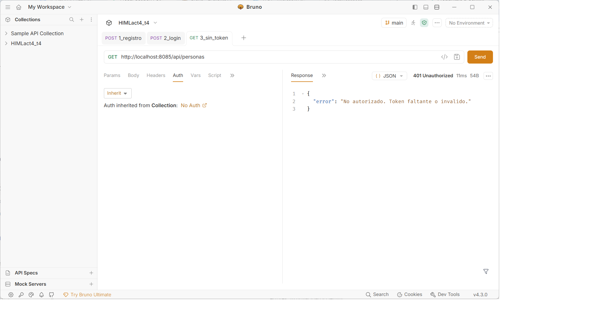
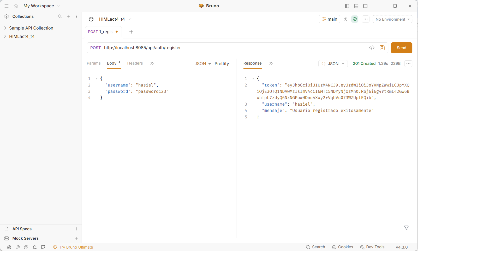
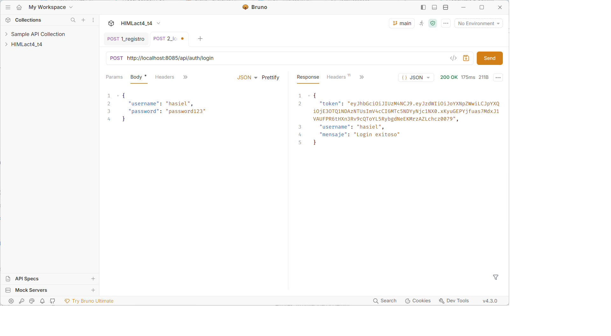

# Actividad 4: API REST con Spring Boot, Spring Security y JWT

API RESTful desarrollada en **Java 21** y **Spring Boot** que implementa operaciones CRUD sobre la entidad `Persona` (relacionada con `CiudadOrigen` en MySQL), aplicando arquitectura en capas, DTOs, validaciones con Bean Validation (`@Valid`), paginación y autenticación stateless mediante **Spring Security + JWT**.

- **URL base en producción (VPS):** `http://20.98.89.81:8085`
- **Colección de pruebas:** Incluida en la carpeta `/HIMLact4_t4` (compatible con Bruno API Client).

---

## Tecnologías Utilizadas
- Java 21 & Spring Boot
- Spring Web (REST API pura en formato JSON)
- Spring Data JPA + MySQL 8
- Spring Security + JJWT (JSON Web Tokens)
- Jakarta Bean Validation (`@Valid`)
- Bruno API Client (colección versionada en Git)

---

## Endpoints de la API

### Autenticación (Públicos)
| Método | Endpoint | Descripción | Código esperado |
| :--- | :--- | :--- | :--- |
| `POST` | `/api/auth/register` | Registra un nuevo usuario encriptando su contraseña con BCrypt. | `200 OK` / `400 Bad Request` |
| `POST` | `/api/auth/login` | Autentica credenciales y devuelve un token JWT válido. | `200 OK` / `401 Unauthorized` |

### CRUD de Personas (Protegidos con `Authorization: Bearer <token>`)
| Método | Endpoint | Descripción | Código esperado |
| :--- | :--- | :--- | :--- |
| `GET` | `/api/personas?page=0&size=10` | Lista las personas de forma paginada usando `PersonaResponseDTO`. | `200 OK` / `401 Unauthorized` |
| `GET` | `/api/personas/{id}` | Obtiene el detalle de una persona por su ID. | `200 OK` / `404 Not Found` |
| `POST` | `/api/personas` | Crea una nueva persona validando los datos de entrada. | `201 Created` / `400 Bad Request` |
| `PUT` | `/api/personas/{id}` | Actualiza los datos de una persona existente. | `200 OK` / `404 Not Found` |
| `DELETE` | `/api/personas/{id}` | Elimina una persona por su ID. | `200 OK` / `404 Not Found` |

---

## Evidencias de Pruebas en Bruno

### 1. Acceso denegado sin Token JWT (`401 Unauthorized`)

### 2. Registro de Usuario (`POST /api/auth/register`)

### 3. Inicio de Sesión y Obtención de Token (`POST /api/auth/login`)

### 4. Listar Personas Paginadas con Token (`GET /api/personas`)

### 5. Consultar Persona Individual (`GET /api/personas/{id}`)

### 6. Crear Nueva Persona (`POST /api/personas`)

### 7. Actualizar Persona (`PUT /api/personas/{id}`)

### 8. Eliminar Persona (`DELETE /api/personas/{id}`)

